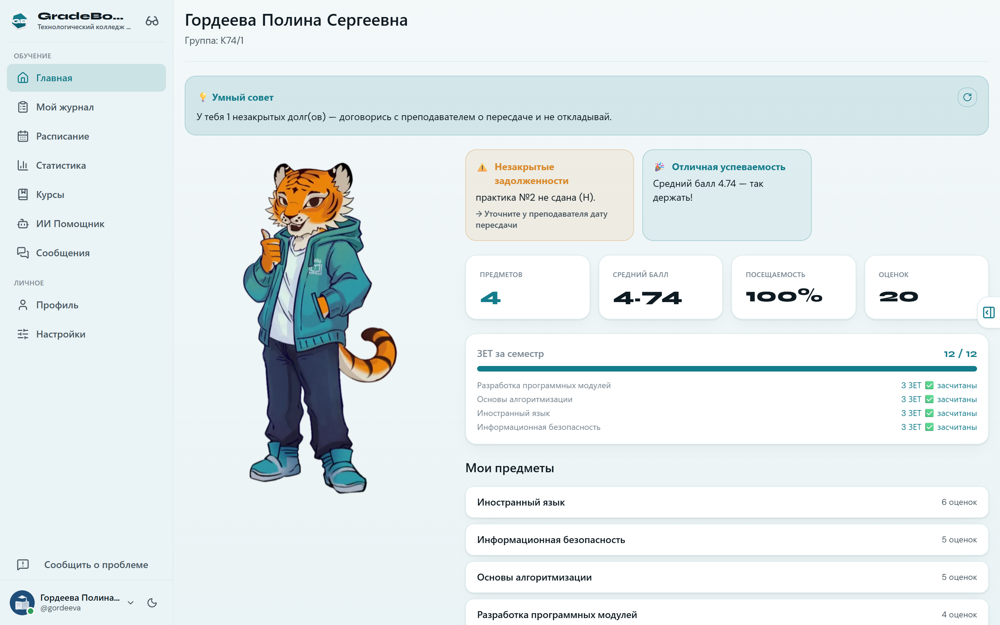
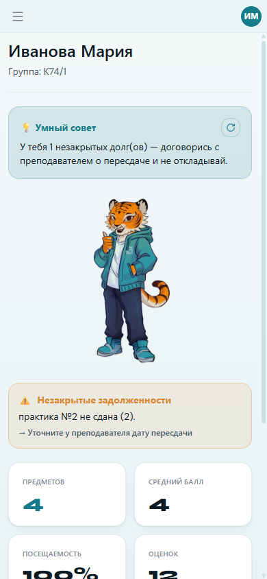
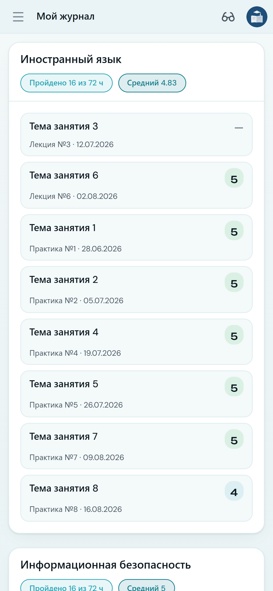
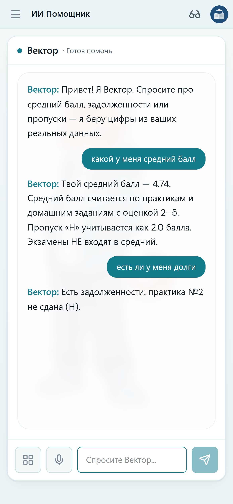
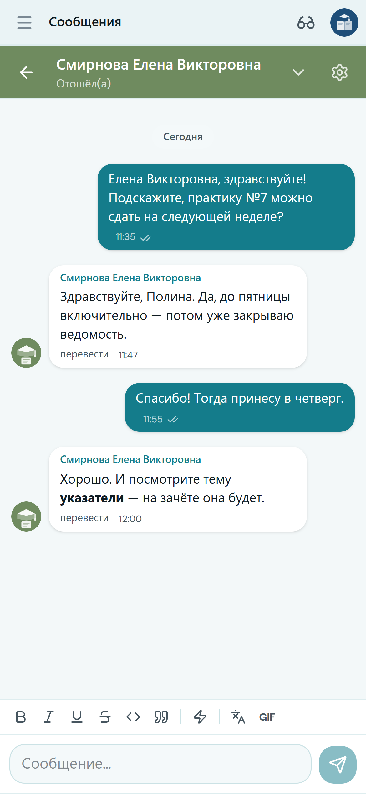
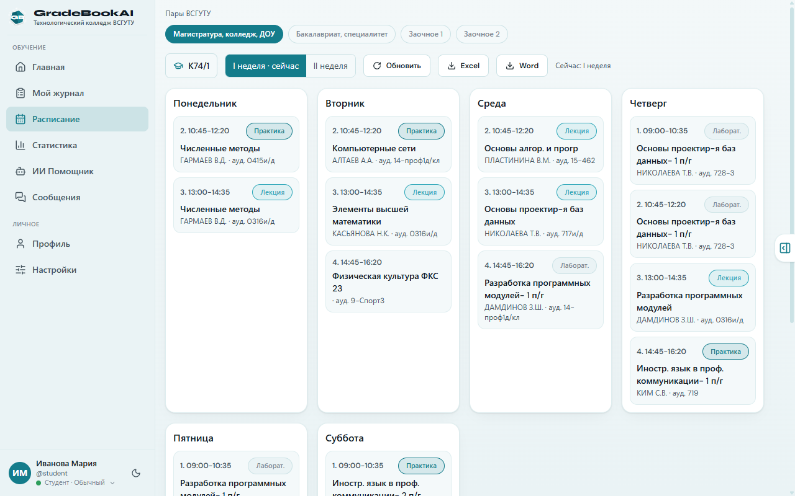
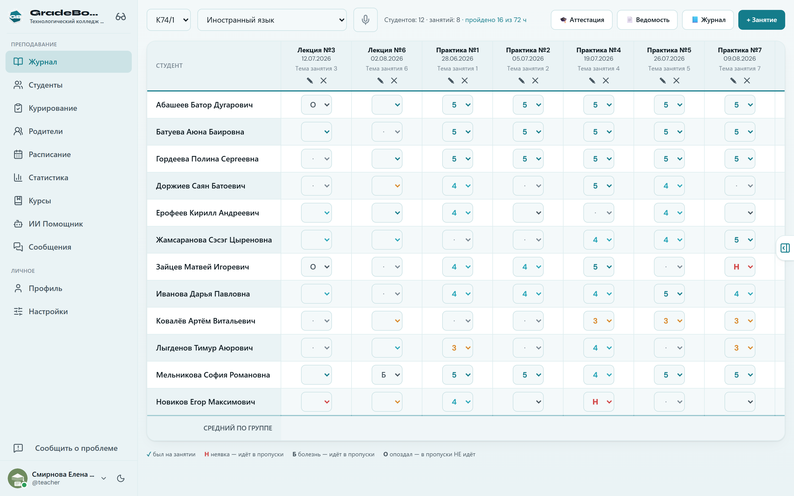
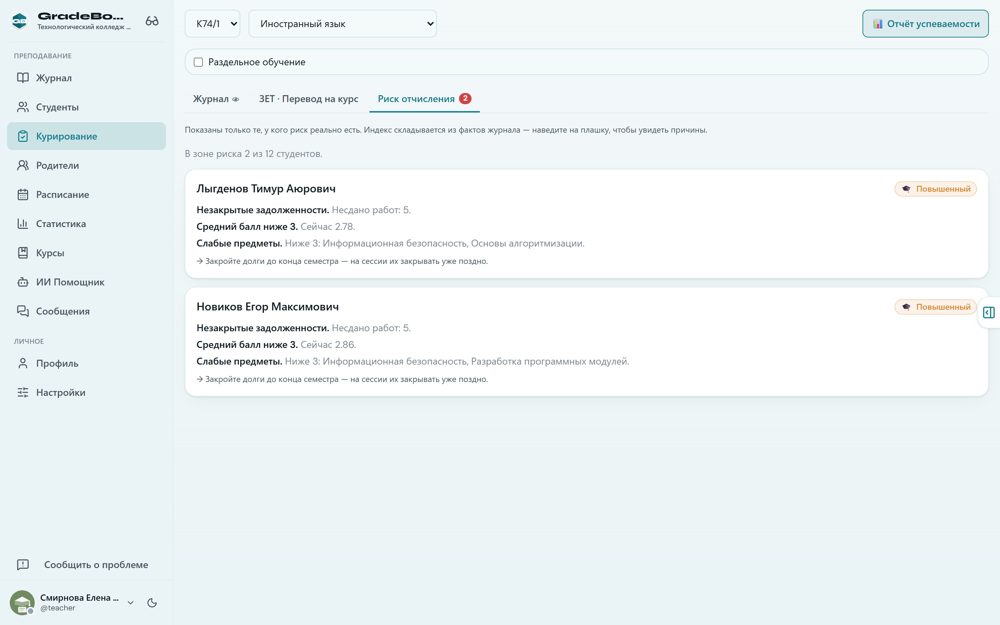
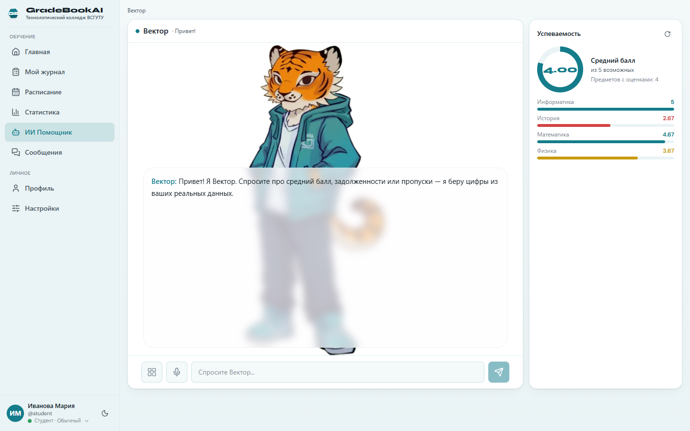
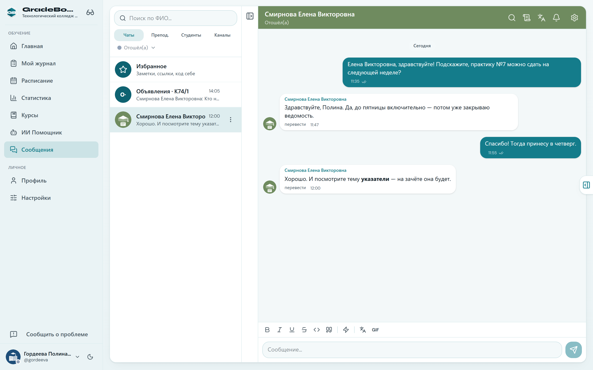

<div align="center">

# GradeBookAI

**Электронный журнал успеваемости для колледжей и вузов России**
*Работает без интернета. ИИ-помощник берёт цифры из базы, а не из головы.*

[](https://esstu-gradebook.ru)
[](https://esstu-gradebook.ru/downloads/GradeBookAI.exe)

[](#соответствие-152-фз-и-требованиям-фстэк)
[](#для-разработчиков)
[](CHANGELOG.md)
[](#тесты)

*Победитель хакатона «Мы — будущее IT Бурятии» (март 2026)*



</div>

---

## Журнал, который не останавливается вместе с интернетом

В учебном корпусе связь есть не везде. Обычный «облачный» журнал в этот момент просто
перестаёт работать: преподаватель записывает оценки на бумагу и переносит их вечером —
если не забудет.

**GradeBookAI работает наоборот.** Оценка сохраняется мгновенно на компьютере преподавателя,
а когда сеть появляется — сама уходит на сервер колледжа. Ничего не теряется, никто никого
не ждёт.

---

## Что решает

| Боль учебной части | Что делает GradeBookAI |
|---|---|
| Оценки живут в разных файлах Excel у каждого преподавателя | Один журнал на весь колледж: сервер и база общие для ПК, сайта и телефона |
| Сводку по группе и должникам собирают руками к каждому совещанию | Средний балл, долги, пропуски и зона риска считаются сами и всегда актуальны |
| Пропал интернет — работа встала | Offline-first: запись идёт локально, синхронизация — фоном |
| Преподаватели и студенты общаются в личных мессенджерах, вне контура вуза | Встроенный мессенджер с модерацией: переписка остаётся в системе колледжа |
| ИИ-помощники «придумывают» показатели | «Вектор» берёт каждую цифру SQL-запросом к реальной базе |
| ПДн студентов и проверка по 152-ФЗ | Шифрование при хранении, ГОСТ-хеши паролей, журнал аудита, сервер в РФ |

---

## Что получает колледж

**Один журнал — три экрана.** Десктоп для преподавателя, сайт для всех, приложение на
телефоне у студента. Данные общие: оценка, выставленная на паре, видна студенту сразу.

<table>
<tr>
<td width="62%" valign="top">

Интерфейс **один на все платформы** — Vue-приложение, которое сайт, программа и
телефон показывают одинаково. Поэтому новая функция появляется везде сразу, а не
«сначала на сайте, потом когда-нибудь на телефоне».

На телефоне раскладка не сжимается, а **пересобирается**: боковое меню уходит за
бургер, маскот становится мелким и встаёт в строку с именем, а оценки и пропуски
поднимаются в первый экран — на них смотрят чаще всего.

</td>
<td width="38%" align="center" valign="top">
  
</td>
</tr>
</table>

<table>
<tr>
<td width="33%" align="center"><br><sub>Журнал оценок</sub></td>
<td width="33%" align="center"><br><sub>Вектор берёт цифры из базы</sub></td>
<td width="33%" align="center"><br><sub>Мессенджер</sub></td>
</tr>
</table>
<div align="center"><sub>Один и тот же интерфейс на телефоне — без горизонтальной прокрутки на любом экране (держит статический сторож вёрстки).</sub></div>

**Считает само.** Средний балл, задолженности, пропуски (Н/Б/О), зона риска, ведомости и
аттестация. Методика расчёта настраивается под правила вуза, а не зашита в код.

**Общение внутри контура вуза.** Встроенный мессенджер: личные чаты, группы и каналы
объявлений (создают преподаватели), ответы и пересылка, закрепление, поиск по ФИО.
Работает на всех трёх платформах.

**Учебные курсы.** Преподаватель собирает по своему предмету курс: структуру, материалы
(ссылки и пояснения), задания — всё видно студентам группы в отдельном разделе. Курс не
удаляется, а архивируется: история курса — учебный документ.

**Модерация с подотчётностью.** Жалоба на сообщение создаёт тикет со снимком текста, а
чат «Написать модерации» даёт студенту официальный канал обращения. Администратор может
удалить нарушающее сообщение и ограничить нарушителя в переписке. Каждый просмотр чужой
переписки записывается в журнал аудита — это требование 152-ФЗ, а не опция.

**Оценки голосом.** Преподаватель говорит «Гордеевой пять, Петров болеет» — журнал
разбирает команду и показывает список на подтверждение. Разбор команды идёт без языковой
модели, по реальному списку группы, и ничего не записывается без подтверждения человеком.
Можно поставить оценку всей группе одной фразой.
Чем распознавать речь, решает администратор: **Whisper на сервере колледжа** (звук не
покидает контур вуза) или распознавание браузера. По умолчанию — только свой сервер: где
Whisper не установлен, голосовой ввод выключен, а отдать звук облачному сервису браузера
можно лишь явным выбором администратора.

**Вектор отвечает голосом.** Помощник не только пишет, но и проговаривает ответы вслух —
на выбор мужской или женский голос, синтез на сервере (Silero). Без связи с сервером ответ
читает системный голос компьютера. Голосовой ответ можно отключить в настройках.

**Уведомления на телефон.** Студент получает пуш о новой оценке и об изменении своего
расписания — адресно, только тем, кого правка реально коснулась. В уведомлении нет ПДн.

**Расписание уже внутри.** Пары и список предметов подтягиваются с портала ВСГУТУ
автоматически — вручную ничего вбивать не нужно. Читаются все категории портала:
колледж, бакалавриат и специалитет, обе заочные формы — включая сессионное расписание,
где днями выступают календарные даты, а не «понедельник — суббота».

**Учебный план заносится с сайта вуза.** Администратор выбирает специальность и год
поступления — журнал сам разбирает опубликованный план и заводит группе предметы, часы и
ЗЕТ **того семестра, который идёт сейчас**, а не всю четырёхлетнюю программу разом. Курс
и семестр считаются от года поступления, поэтому в сентябре ничего переключать не нужно.

**Раздельное обучение по подгруппам.** Предмет может вести два преподавателя параллельно —
каждый своей половине группы (обычный случай для иностранного языка и физкультуры), либо
один преподаватель, но подгруппами по очереди, если класс маленький. Куратор отмечает
предмет и расставляет студентов, дальше каждый преподаватель видит в журнале только свою
подгруппу, а нумерация занятий у подгрупп независимая — чтобы никто не сбивался со счёта.
Студент видит только те занятия, которые действительно относятся к нему.

<div align="center">
  
  <br>
  <sub>Реальные пары с портала ВСГУТУ: категория, группа, чётность недели.
  Администратор может править ячейки поверх портала — правки видят студенты и «Вектор».</sub>
</div>

**Экспорт в привычные форматы.** Журналы и ведомости выгружаются в Excel и Word — для
отчётности и подписи.

<table>
<tr>
<td width="50%" align="center" valign="top">
  
  <br><sub>Журнал преподавателя: оценки и посещаемость по занятиям, легенда меток
  под таблицей, кнопка ввода оценок голосом.</sub>
</td>
<td width="50%" align="center" valign="top">
  
  <br><sub>Раннее предупреждение об отчислении у куратора: только те, у кого риск
  реально есть, с разбором причин по каждому.</sub>
</td>
</tr>
</table>

---

## «Вектор» — ИИ-помощник, которому можно верить

Главный риск ИИ в учебном заведении — красиво выдуманная цифра. Средний балл, который
модель «придумала», хуже, чем отсутствие ИИ вообще.

**Поэтому в GradeBookAI языковая модель не считает и не знает цифр.** Она отвечает только
за формулировку:

```text
Вопрос преподавателя
   ↓
Распознаём намерение              локально, без сети и без модели
   ↓
SQL-запрос к реальной базе        ← здесь и только здесь появляются цифры
   ↓
Есть в ответе ФИО?  ── да ──→  отдаём готовый текст как есть, в модель не уходит ничего
   ↓ нет
Модель переформулирует готовый факт (числа не трогает)
```

Что это значит на практике:

- **Цифры всегда сходятся с журналом** — они из журнала и взяты.
- **Фамилии студентов в модель не отправляются.** Вопрос, где названа фамилия из журнала,
  к модели не попадает вовсе; ответы, где перечислены люди (списки группы, должники),
  отдаются человеку как есть, без модели; перевод ответа на другой язык идёт моделью
  только для текста без фамилий. Обезличивать нечего — модель такой текст не видит.
  Сторож-тест перехватывает тексты, которые Вектор отдаёт модели на переформулировку, и
  краснеет, если там встретится фамилия живого пользователя.
- **У каждой роли своя выборка.** Студент спрашивает о себе, преподаватель — о своих
  группах, администратор — о колледже целиком. Ответы всех ролей собраны в карту
  (`docs/contracts/vector-map.json`), и правка любого ответа видна в ней строкой.
- **ИИ не обязателен для работы.** Нет сети или модели — отвечает встроенный шаблонизатор.
  Журнал не зависит от внешнего сервиса.
- **Выбор модели за вузом:** офлайн-режим, российский **GigaChat** или локальная модель
  **Ollama** на своём железе (наружу не уходит ничего).
- **Факты о вузе** отвечаются из выверенного справочника, а не генерацией.

«Вектор» — ещё и маскот колледжа: тигр с рисованной анимацией, который машет при встрече,
задумывается над вопросом, говорит вслух синхронно с анимацией и реагирует на успеваемость
студента.

<div align="center">
  
  <br>
  <sub>Рядом с перепиской — сводка успеваемости: общий средний и каждый предмет отдельно.
  Цвет полосы дублируется числом, поэтому сводка читается и в чёрно-белой печати.</sub>
</div>

---

## Мессенджер: общение внутри журнала, а не в чужом чате

Переписка преподавателей со студентами обычно живёт там, где журнала нет: личные номера
в WhatsApp, беседы «ВКонтакте», группы, где вперемешку учебные объявления и мемы. Для
учреждения, отвечающего за персональные данные студентов, это проблема — переписка о
успеваемости уходит на чужие серверы, а куратор не может ни подтвердить, ни отозвать
доступ. Здесь общение встроено в сам журнал.

**Что есть:**

- **Личные чаты, группы и каналы.** Группы и каналы заводят только преподаватели и
  администрация — у студента остаются личные чаты, чтобы курс не превращался в стихийные
  беседы на сотню человек.
- **Куратор добавляет учебную группу одним действием** — все студенты его группы попадают
  в чат сразу, без ручного перебора списка.
- **Системные каналы ведёт сам журнал:** «Мои оценки» (новая оценка приходит адресно),
  «Расписание · группа» и «Замены», «Объявления», «Отчёты» для родителей. Их не нужно
  наполнять руками — это те же события, что уже происходят в журнале.
- **Отчёт куратора родителям** — команда `/отчет` в канале группы: кнопка с диаграммой
  успеваемости, где цифры пересчитываются при каждом открытии, а не остаются снимком.
- **«Вектор» отвечает прямо в чате** по команде `/vector` — с тем же запретом выдумывать
  цифры и с тем же скоупом по роли, что и на его вкладке.
- **Оформление сообщений:** markdown-лайт (**жирный**, списки, цитаты, код), реакции,
  ответы и треды, упоминания трёх степеней громкости, пересылка, закрепление, «Избранное»
  как личный блокнот, черновики, поиск по переписке, напоминания о сообщении.
- **Опросы прямо в чате:** вопрос с вариантами, срок, анонимность и правило раскрытия
  итога подписаны до голосования; у завершённого опроса виден победитель, ничья
  отмечается честно. Опрос закрывается сам по сроку — голоса не теряются.
- **Ссылки и медиа:** переход по внешней ссылке — только после подтверждения, видео с
  YouTube/VK/Rutube разворачивается плеером по белому списку, GIF — встроенный пикер.
  Сервер никуда не ходит за превью: адрес разбирается на месте, поэтому подсунуть
  журналу чужой запрос через ссылку нельзя.
- **Трекер задач прямо в беседе.** Владелец включает его в настройках беседы: работы,
  задачи с исполнителями и сроками, доска, список, сроки и сводка. Правки уходят на
  сервер одной пачкой по кнопке «Сохранить», и назначенный получает одно уведомление со
  всеми своими задачами, а не письмо на каждую.
- **Переводчик сообщений** — офлайновый (Argos), считает на сервере вуза: переписка не
  уходит ни в облачный переводчик, ни в языковую модель. Ставится на машину колледжа
  отдельно (нужна память); где не установлен, кнопка честно говорит об этом.

**Порядок и безопасность заложены в механику, а не в правила поведения:**

- мат маскируется автоматически при отправке и правке — сообщение не блокируется, но и
  не публикуется как есть;
- анти-флуд предупреждает голосом маскота с растущей паузой, прежде чем отказать;
- жалоба на сообщение и отдельный чат обращений к модерации — две разные двери, обе
  ведут в админ-панель;
- заглушить беседу можно у себя, а модерация может заглушить нарушителя глобально;
- удаление переписки — **личное действие**: у собеседника его копия остаётся, чужие
  данные никто не стирает;
- роли внутри беседы (кик, выдача ролей, `/mute`, `/clear`) выдаются точечно, а не «всем
  преподавателям сразу».

<div align="center">
  
  <br>
  <sub>Личный чат: галочки «отправлено/прочитано», разделитель по датам, markdown-лайт,
  кнопка перевода под сообщением, панель форматирования и GIF-пикер.</sub>
</div>

Переписка **не покидает сервер колледжа** и не входит в офлайн-копию на компьютерах: это
единственная подсистема продукта, намеренно оставленная только онлайн — историю сообщений
не нужно носить с собой, а её утечка вместе с украденным ноутбуком была бы худшим исходом,
чем невозможность прочитать чат в дороге.

---

## Раннее предупреждение об отчислении

Отчисление почти никогда не бывает внезапным: к нему ведёт цепочка, которую видно за
месяцы. Проблема в том, что видно её **по частям** — у каждого преподавателя «ну, средненько»,
и только вместе это складывается в приговор. Журнал складывает за них.

**Индекс риска считается из фактов журнала, а не предсказывается моделью.** Учитываются:
несданные экзамены и зачёты (после всех попыток), незакрытые задолженности, средний балл,
доля пропусков (отдельно — неуважительные), число просевших предметов, предметы без единой
отметки, недобор ЗЕТ к порогу перевода. Каждый фактор виден отдельной строкой с
объяснением — цифру можно проверить и оспорить.

Кто что видит:

- **Преподаватель** — плашку риска прямо в списке студентов группы, по своим предметам.
- **Куратор** — вкладку «Риск отчисления» со всей группой сразу, отсортированную по
  тяжести, с разбором причин по каждому студенту. Плюс уведомление, когда у кого-то
  уровень **вырос** (а не после каждой двойки — иначе такие письма перестают читать).
- **Студент** — свой риск в «Умном совете»: из-за каких предметов и что конкретно делать.
- **Родитель** — то же, что видит его студент.

⚠️ Риск показывается, **только когда он реально есть**. «Риск 1 %» не показывается никому:
если тревожный сигнал горит у трети группы, его перестают замечать — и он не сработает
тогда, когда действительно понадобится.

---

## Соответствие 152-ФЗ и требованиям ФСТЭК

Покупатель — бюджетное учреждение, которое отвечает за персональные данные студентов.
Безопасность заложена в архитектуру, а не добавлена сверху:

- **База сервера зашифрована при хранении** — SQLCipher (AES-256). Украденный файл базы
  не прочитать без ключа.
- **Пароли — гибридный хеш с российской криптографией:** PBKDF2-HMAC-SHA512 (200 000
  итераций) → PBKDF2-Стрибог512 (ГОСТ Р 50.1.111-2016). В открытом виде пароль не хранится.
- **Данные на компьютере преподавателя** — локальная база программы зашифрована целиком
  (SQLCipher, AES-256), ключ устройства защищён Windows DPAPI. При смене пользователя на
  общем компьютере база прежнего стирается.
- **Канал** — только HTTPS/TLS, сервер размещается **на территории РФ** (152-ФЗ, ст. 18 ч. 5).
- **Обновления подписаны.** Программа для Windows проверяет подпись Ed25519, приложение на
  телефоне — подпись ECDSA у каждого пакета интерфейса. Контрольная сумма, приехавшая тем
  же каналом, что и файл, от подмены не спасает, поэтому без верной подписи обновление не
  ставится. По незашифрованному адресу запрос не делается вообще, в том числе виджетом
  расписания.
- **Журнал аудита** (приказ ФСТЭК России № 21): входы, изменения оценок и ПДн, каждое
  действие модерации. Каждая запись несёт хеш предыдущей, поэтому правка, удаление или
  вставка задним числом заметны; проверка — отдельной утилитой мимо самого приложения.
- **Приманки.** Пути, к которым законный пользователь не обращается никогда (`/.env`,
  чужие админки), и учётка-приманка сразу фиксируют попытку в постоянном журнале.
  Сетевой адрес в журнал не пишется — только его отпечаток.
- **Разграничение доступа по ролям** на уровне запросов: студент не получит данные другого
  студента даже при попытке обойти интерфейс. Преподаватель видит только свои группы.
  В мессенджере доступ к переписке имеют только её участники.
- **Устойчивость к злоупотреблению:** ограничение частоты отправки сообщений, отключение
  уведомлений по беседе, ограничение нарушителя модерацией, лимиты на длину сообщений и
  публичных полей профиля.
- **Управление доступом:** вход по паролю, по ключу доступа (Face ID / отпечаток / passkey),
  второй фактор по одноразовому коду (по желанию человека), код из письма при входе с нового
  устройства, мгновенный отзыв токена администратором, подтверждение новых компьютеров
  программы администратором, защита от перебора паролей. Смена почты и телефона требует
  текущий пароль. Сессия на чужом компьютере живёт часы, а не недели: длиннее она только
  на доверенном устройстве или со вторым фактором.
- **Проверка по чек-листу OWASP ASVS 5.0.** Вердикт по каждому требованию лежит в
  репозитории вместе с доказательством — файлом и строкой, которую тест ищет при каждом
  прогоне. Уедет защита — вердикт покраснеет.
- **Импортонезависимый стек:** Python, Vue, FastAPI, SQLite (SQLCipher), GigaChat. Зарубежные
  облака для работы не требуются; поиск GIF и погода в приветствии выключаются настройкой.

---

## Как выглядит внедрение

1. **Сервер** — на технику колледжа или на российский хостинг. База и ПДн остаются у вуза.
2. **Администратор** заводит группы, преподавателей и студентов (или импортирует из Excel).
3. **Преподаватели** ставят десктоп-клиент; студенты заходят на сайт или ставят приложение.
4. **Настройка правил** — методика среднего балла, роли, режим ИИ, правила модерации.

Закупка возможна по **44-ФЗ / 223-ФЗ**: продукт российский, лицензия и поддержка
оформляются договором с командой.

---

## Частые вопросы

**Что будет, если пропадёт интернет?**
Преподаватель продолжает работать: оценки пишутся в локальную базу и встают в очередь, а когда
связь вернётся, уходят на сервер строго по порядку. Если кто-то успел изменить ту же оценку
раньше, правка не затирается молча — преподаватель видит её в разделе «Что не ушло на сервер» и решает
сам. Мессенджер — онлайн-часть: переписка требует связи с сервером.

**Куда уходят персональные данные студентов?**
Никуда за пределы контура вуза. Сервер — ваш, база — ваша. В облачную модель (если её вообще
включили) ответы с ФИО не уходят совсем: модель получает только тексты без имён.

**Можно ли работать вообще без ИИ?**
Да. ИИ — отдельный слой. Отключается целиком, журнал работает как обычный.

**Нужен ли мощный сервер?**
Нет. Для колледжа достаточно обычного ПК или недорогого VPS. Локальная модель ИИ
опциональна — она нужна только если вуз хочет держать ИИ на своём железе.

**Есть ли мобильное приложение?**
Да, Android. Обновляется «по воздуху» — новые версии интерфейса приходят без переустановки
из магазина. На рабочий стол можно вынести **виджет расписания** трёх размеров: от
маленького «что сейчас» до полного дня с преподавателем и аудиторией. Какой сегодня
день, какая неделя и какая пара идёт, телефон считает сам — поэтому виджет остаётся
верным и без сети. Раз в несколько часов он сам забирает свежее расписание с публичного
адреса (без входа в аккаунт и только по защищённому каналу), так что не устаревает, даже
если приложение не открывать неделями.

**Кто может читать переписку студентов?**
Только участники беседы. Администратор-модератор может открыть переписку при разборе
жалобы — и каждый такой просмотр фиксируется в журнале аудита с указанием, кто и когда
смотрел.

---

## Статус проекта

Продукт находится в стадии **Release 4.1.6** и готовится к первому коммерческому внедрению
во ВСГУТУ. Работающее демо доступно публично: **[esstu-gradebook.ru](https://esstu-gradebook.ru)**.

Функционально продукт собран: десктоп, сайт и мобильное приложение работают на общей базе,
безопасность и разграничение доступа заложены в архитектуру. С 30.09.2026 идёт доводка до
стабильного выпуска: новых функций нет, только исправления, проверки и документы.

Что происходит при внедрении в вузе:

- **База данных** — SQLite под SQLCipher (AES-256) и на демо-стенде, и на сервере вуза.
  Второй СУБД в продукте нет: поддержку PostgreSQL убрали 04.09.2026, потому что её не
  проверял ни один тест, а непроверенная ветка — ложная уверенность, а не возможность.
- **Криптография** — на технике вуза используется сертифицированное СКЗИ; в коде уже
  реализованы шифрование БД (SQLCipher) и ГОСТ-хеши паролей.
- **Данные** — боевое наполнение реальными журналами колледжа выполняется после заключения
  договора. Всё, что видно в демо, — тестовые данные.

Что уже сделано — в [CHANGELOG.md](CHANGELOG.md).

---

## Команда Synapse

| Участник | Роль |
|---|---|
| **Ярослав** | Технический лид, архитектура, продукт |
| **Владислав** | Бэкенд |
| **Арина** | Фронтенд, арт и анимация маскота, презентации |

Улан-Удэ, Республика Бурятия.

**Synapse — where ideas click.**

---

# Для разработчиков

Монорепо: **десктоп** в корне, **сервер** (FastAPI) в [`server/`](server/),
**веб-клиент** (Vue 3) в [`web/`](web/), **Android-обёртка** (Capacitor) в
[`web/android/`](web/android/).

## Быстрый старт

Зависимости описаны в [`pyproject.toml`](pyproject.toml) (PEP 621) и зафиксированы в
`uv.lock` — установка воспроизводима на любой машине:

```bash
# Зависимости через uv (быстрее pip, сам берёт нужный Python — на машине с двумя
# интерпретаторами это снимает целый класс наших проблем)
uv sync --extra desktop --extra server --extra dev

# Десктоп (Python 3.10+; сборка релиза — на Python с python.org, не из Microsoft Store)
uv run python main.py                # окно программы

# Сервер (dev)
cd server && uv run uvicorn app.main:app --reload --host 0.0.0.0 --port 8000

# Веб (dev / сборка)
cd web && npm install && npm run dev  # http://localhost:5173
cd web && npm run build               # → web/dist

# Стенд с выдуманным колледжем для ручной проверки (без единой живой ПДн)
python -X utf8 tools/qa_stand.py      # http://127.0.0.1:8765
```

`requirements.txt` и `server/requirements.txt` продолжают работать (боевой VPS
разворачивается ими) — они производные от `pyproject.toml`. Порядок полного перехода —
[`docs/done/PLAN-PACKAGING.md`](docs/done/PLAN-PACKAGING.md).

## Тесты

Держим зелёными: **1143 клиентских**, **2359 серверных**, **956 веб-тестов**
(23.10.2026, без красных и пропущенных). Линтеры — `ruff` для Python и ESLint 9 для веба,
типы — `mypy` по списку уже типизированных модулей (настройки в `pyproject.toml`).
CI на GitHub гоняет то же самое плюс SAST (bandit) и поиск секретов (gitleaks).

```bash
pytest                    # клиентские тесты (из корня)
cd server && pytest       # серверные тесты (~9 минут: в тестах хеш пароля облегчён, сеть закрыта)
cd web && npm test        # веб-тесты (node --test, без внешних раннеров)
cd web/android && ./gradlew :app:testDebugUnitTest   # Android, устройство не нужно
```

Часть тестов — **контракты между платформами**: одни и те же наборы данных
(`docs/contracts/`) проверяют Python и JavaScript, а расчёт чётности учебной недели —
ещё и Java-код виджета. Разъехаться втроём нельзя: контракт покраснеет.

Отдельно стоит **статический сторож мобильной вёрстки** (`web/tests/mobileLayout.test.mjs`):
он ловит по разметке то, что гарантированно даёт горизонтальную прокрутку на телефоне —
таблицу без прокрутки, сетку без колонки на узком экране, обрезку текста без разрешения
сжиматься. У каждого правила есть обратный тест: правило обязано срабатывать на той
разметке, которая когда-то вызвала баг, — иначе сторож незаметно перестаёт что-либо
проверять и создаёт ложную уверенность.

Трогаешь синхронизацию, хеш паролей, реконсиляцию, подтверждение устройств, веб-запись
или мессенджер — **дополни тесты**.

## Карта репозитория

Монорепо состоит из четырёх частей: **общие корневые модули** (правила, одинаковые для
всех платформ), **десктоп** (корень + `desktop/ data/ sync/ schedule/`), **сервер**
(`server/`) и **веб** (`web/`, он же мобильное приложение).

### Общие корневые модули — правила, которые обязаны совпадать везде

Чистый stdlib, ноль зависимостей. Их импортируют И сервер, И десктоп: вторая копия
любого из этих правил означала бы «в журнале одно, в кабинете другое».

| Файл | Что внутри |
|---|---|
| `grading.py` | **Единый** расчёт среднего балла, шкалы преподавателей (5-балльная/100/буквенная/зачёт), распознавание «завалено». Веса — из конфига, не хардкод |
| `study_hours.py` | Учебные часы и ЗЕТ: занятие = пара = 2 ч, курс/семестр от года поступления, «сдан ли предмет» |
| `dropout_risk.py` | **Риск отчисления** (3.6): факторы, веса, уровни, порог видимости. Не модель, а прозрачная арифметика по правилам |
| `vector_nlu.py` | **Единый** лексикон и классификатор намерений Вектора |
| `voice_command.py` | Разбор голосовых команд преподавателя (оценки/пропуски) — детерминированно, без LLM |
| `profanity_filter.py` | Цензура мата в мессенджере: поиск по корню, маска `█` (безопасна для markdown) |
| `reminder_parse.py` | Разбор дат напоминаний («завтра в 9») — тоже без LLM |
| `desktop_update.py` | Правила автообновления: сравнение версий, имена патчей, хеши, выбор дельты; строка версии `APP_VERSION` |
| `college_clock.py` | Время колледжа (Улан-Удэ): «сегодня», учебный день, показ человеку; хранится UTC |
| `estimators.py` | Статистика по малой выборке: интервал Уилсона, сглаживание Байеса — Лапласа, тренд Тейла — Сена |
| `teacher_match.py` | Сопоставление ФИО преподавателя из расписания портала с учётной записью |
| `weather.py` | Погода для приветствия Вектора (упоминается только когда она заметная) |

### Десктоп

> **Интерфейса на Qt в проекте нет.** Окно рисует системный движок Edge (WebView2) поверх
> локального серверного приложения, то есть десктоп показывает ТУ ЖЕ Vue-SPA, что сайт и
> мобильное приложение. Нативные экраны, дизайн-система Qt и модуль `_bootstrap.py`
> удалены; папка `ui/` переименована в `desktop/` — интерфейса в ней не осталось.

| Путь | Что внутри |
|---|---|
| `main.py` | Точка входа: применение отложенного обновления → БД → окно |
| `app_paths.py` | Единый источник путей (портативность .exe); кросс-совместимо с PyInstaller и Nuitka |
| `log.py` | Логирование |
| `desktop/webview2_app.py`, `desktop/webview2_shell.py` | **Единственное окно программы** — системный движок Edge (WebView2) через pywebview |
| `desktop/local_api.py` | Поднимает **настоящий** `server/app` на 127.0.0.1 в потоке; мост входа, передача сессии, прокси онлайн-разделов |
| `desktop/local_mirror.py` | Зеркало боевой базы в локальную копию по серверному номеру изменения |
| `desktop/route_policy.py` | Куда идёт каждая запись из программы: на сервер, в очередь досылки или только локально (с записанной причиной) |
| `desktop/desk_outbox.py` | Очередь досылки правок журнала: строго по порядку, конфликт решает человек |
| `desktop/single_instance.py`, `desktop/temp_cache.py` | Одна копия программы на папку данных; кэш быстрого старта под ключом устройства |
| `desktop/server_admin.py` | Раздел «Сервер» по SSH — **только локально**, на бою этого кода нет вовсе |
| `data/core.py` | `DBManager`: SQLite (WAL), копии, конфликты синка. **Единственная дверь к базе** |
| `data/local_db.py` | Шифрование локальной базы целиком (SQLCipher), смена владельца базы на общем компьютере |
| `data/security.py` | Хеш пароля (PBKDF2-SHA512 + Стрибог), Fernet, DPAPI |
| `data/app_settings.py`, `data/data_store.py` | Настройки приложения и key-value хранилище |
| `data/updater.py` | Клиент автообновления: скачивание, проверка подписи, подмена .exe переименованием |
| `data/student_link.py`, `data/audit.py`, `data/terms.py` | Доклейка `student_id`, анти-брутфорс, учебные периоды |
| `sync/sync_client.py` | HTTP-клиент к серверу (единственный путь к общим данным) |
| `sync/sync_runner.py` | Фоновый поток синхронизации; сброс всего, что привязано к прежнему человеку, при смене пользователя |
| `sync/verifier.py` | «Сверщик»: только читает и проверяет, что локальная копия совпадает с сервером |
| `archive/` | Код, выведенный из продукта: прежний движок синка `sync_engine.py` (с 25.09.2026), база знаний модерации и другое. Не исполняется; вернуть импорт не даёт тест |
| `schedule/parser.py` | Парсер `portal.esstu.ru` на stdlib (без BeautifulSoup — чистые лицензии), пять категорий, два формата страницы |
| `schedule/store.py`, `schedule/model.py`, `schedule/reminders.py`, `schedule/overrides.py`, `schedule/conflicts.py` | Зашифрованный кэш по категориям, модель, напоминания, правки поверх портала, накладки |
| `assets/` (`emotions/`, `animations/`, `fonts/`, `specialties/`) | Исходники арта маскота (30 эмоций + анимации) и шрифтов. Человеку они приезжают из `web/public` — эти папки в релизный .exe не входят |
| `tools/` | `build_mascot_anim.py` (ролики → WebP), `build_android_icons.py`, `build_web_fonts.py`, `make_desktop_patch.py`, `publish_desktop_update.sh`, `graph_rebuild.py` и `graph_api_bridge.py` (карта связей репозитория) |
| `tests/` | Клиентские тесты (`pytest` из корня) |
| `GradeBookAI.spec`, `build_nuitka.sh` | Сборка .exe: дев (PyInstaller) и **релиз** (Nuitka) |

### Сервер (`server/`)

| Путь | Что внутри |
|---|---|
| `app/main.py` | Сборка приложения, проверка боевых секретов при старте, раздача SPA и `/downloads/*` |
| `app/config.py` | Настройки из окружения; **отказ стартовать на бою с дев-ключом подписи** |
| `app/db.py` | Движок SQLAlchemy, SQLCipher, идемпотентные ALTER-миграции, `rebind` для локального сервера |
| `app/models.py` | Все таблицы + `SYNC_MODELS` (что вообще синхронизируется) и форматы ключей |
| `app/sync_clock.py` | Серверный номер изменения (`change_seq`) — курсор синка вместо метки времени |
| `app/security.py`, `app/deps.py`, `app/throttle.py`, `app/audit.py` | Хеш (тот же, что в десктопе), JWT, барьер устройства, анти-брутфорс, аудит с цепочкой хешей |
| `app/secrets_source.py` | Единственная точка чтения секретов: учётные данные systemd → файл → окружение |
| `app/totp.py`, `app/routers/mfa.py` | Второй фактор (одноразовый код из приложения-аутентификатора) |
| `app/login_guard.py` | Защита входа: код из письма при входе с нового устройства, доверенные устройства, сверка контактов |
| `app/canary.py` | Приманки: пути и учётка, к которым законно не обращается никто |
| `app/shared_state.py` | Общее состояние между процессами (Redis, если задан); без него сервер работает одним процессом |
| `app/storage.py` | Вложения мессенджера: способ хранения выбирается по машине (своё хранилище, диск или выключено) |
| `app/webdata.py` | Выборки для `/web/*` строго по роли; сбор фактов для риска отчисления |
| `app/routers/auth.py` | Вход, refresh с абсолютным потолком сессии, регистрация, восстановление |
| `app/routers/sync.py` | `/sync/pull` и `/sync/push`: скоуп по роли, серверные метки LWW, нормализация ключей оценок |
| `app/routers/web/` | Основной API кабинетов, разрезанный по ролям (3.6): `student`, `teacher`, `curator`, `termgrades`, `terms`, `admin_read`, `siteinfo`, `schedule`, `vector`, `write`, `datatransfer`, `achievements`, `courses` + `_common` |
| `app/routers/parent.py` | Кабинет родителя + согласие студента (152-ФЗ) |
| `app/routers/messenger/` | Мессенджер и модерация — ПАКЕТ: `_common.py` + модули по темам, включая трекер задач беседы (онлайн-only, вне синка) |
| `app/routers/me.py`, `admin.py`, `connect.py`, `serverinfo.py`, `appupdate.py`, `desktopupdate.py`, `vector.py`, `webauthn_router.py` | Профиль/уведомления, мониторинг, подтверждение устройств, состояние сервера, OTA Android, автообновление десктопа, озвучка, passkeys |
| `app/schedule_web.py`, `app/parsers/esstu_parser.py` | Серверный парсер расписания и учебных планов ВСГУТУ (PDF) |
| `app/vector_llm.py`, `app/stt_service.py`, `app/tts_service.py`, `app/translate_service.py`, `app/gif_service.py` | LLM-озвучка, распознавание речи, синтез (Silero), перевод, GIF-прокси |
| `app/rustore_push.py`, `app/msg_limit.py`, `app/messenger_ai.py`, `app/curator_report.py`, `app/data_transfer.py`, `app/hostinfo.py` | Пуши, анти-флуд, ИИ-функции чата, отчёты куратора, выгрузка/копии, метрики машины |
| `app/request_metrics.py`, `app/client_metrics.py`, `app/routers/clientreport.py` | Метрики запросов; ошибки интерфейса и время старта у клиентов (`POST /app/client-report`, без ПДн, сводка — в разделе «Сервер») |
| `tests/` | Серверные тесты (`cd server && pytest`) |
| `Caddyfile` | **Единственный** боевой конфиг: реверс-прокси, HTTPS, заголовки безопасности, CSP, сжатие. Сверка с боем — `tools/check_prod_caddyfile.sh` |
| `verify_audit.py`, `rotate_db_key.py`, `mfa_admin.py` | Проверка журнала аудита мимо приложения, смена ключа базы, аварийный сброс второго фактора — только с самой машины |

### Веб (`web/`) — он же мобильное приложение

| Путь | Что внутри |
|---|---|
| `src/api/client.js`, `src/api/endpoints.js` | Axios-клиент (обновление токена, `X-Client: web`) и весь контракт API |
| `src/stores/` | Pinia: `auth`, `theme`, `locale`, `vector`, `messenger`, `tts`, `voice`, `gif`, `profile` |
| `src/layouts/AppShell.vue` | Оболочка: сайдбар, мобильная полоса, оверлей Вектора |
| `src/pages/` | Страницы по ролям: `student/`, `teacher/`, `parent/`, `admin/`, плюс расписание, Вектор, мессенджер, настройки |
| `src/components/` | Маскот, фон-гексагоны, `ui/` (карточки, таблицы, `RiskBadge`, `ZetProgress`), `messenger/` (18 компонентов), `vector/` (сводки по ролям), `journal/` (общий список занятий для студента и родителя), `server/` |
| `src/config/` | `nav.js`, `mascot.js` (порт `emotes.pick`), `roles.js`, `status.js`, `vectorCommands.js` |
| `src/i18n/dictionaries.js` | Тексты интерфейса ru/en/zh (парность ключей держит тест) |
| `src/theme/` | Палитра, токены `--gb-*`, `dataviz.js` (категориальные цвета графиков) |
| `src/utils/` | `grading.js` (контракт с Python), `markdownLite.js`, `videoEmbed.js`, `gifEmbed.js`, `clipboard.js`, `voiceInput.js`; `backLayers.js` и `backButton.js` (системная «назад» на Android: окно → прошлый экран → свернуть), `clientReport.js` (ошибки и время старта на сервер) |
| `public/fonts/` | Фирменные шрифты своими файлами (собираются `tools/build_web_fonts.py`) |
| `tests/` | `node --test`: контракты Python↔JS, i18n-аудит, markdown, видео, сторож мобильной вёрстки |
| `src/services/` | `push.js` (пуши RuStore), `scheduleWidget.js` (снимок расписания для виджета на рабочем столе) |
| `android/` | Capacitor-обёртка (APK для RuStore), OTA-обновления, **виджет расписания**: `ScheduleWidgetProvider` (три раскладки по размеру ячейки), `ScheduleWidgetRefresh` (самообновление без входа в аккаунт, только по защищённому каналу) |
| `deploy/` | Скрипты выкладки сайта и OTA |

### Документация

| Путь | Что внутри |
|---|---|
| `docs/done/PLAN-PACKAGING.md` | **Уход от плоских импортов, `uv`, и куда двигаться вебу и десктопу** (3.6) |
| `docs/done/PLAN-ZET.md`, `docs/done/PLAN-3.1.md`, `docs/done/PLAN-2.10.md` | Планы реализованных релизов |
| `docs/plans/` | Живые планы и очередь работ: безопасность перед продажей, продажа и переезд, несколько процессов, офлайн на телефоне, надстройки мессенджера, ревью на 40 находок |
| `docs/research/` | Замеры и исследования: масштаб сервера, синхронизация против аналогов, целевые показатели (SLO) |
| `docs/business/` | Цена и обоснование, рынок и аналоги, разведка конкурента, хронология для разговора о первенстве, одностраничник для комиссии |
| `docs/security/` | Архитектура безопасности, модель персональных данных, базовый уровень ASVS, регламент инцидентов, субобработчики, сроки хранения, контур ViPNet для ВСГУТУ |
| `docs/operations/` | Регламенты сопровождения: передача сервера, восстановление после аварии, смена ключей, доступность интерфейса |
| `docs/screenshots/` | Снимки экранов: витрина RuStore, телефон, сайт |
| `docs/adr/` | Архитектурные решения (ADR) |
| `docs/done/TTS-PLAN.md`, `docs/plans/PLAN-MOBILE-OFFLINE.md` | Озвучка, офлайн на мобилке |
| `docs/done/outdated/` | Устаревшие снимки (техдолг, прод-план, ИИ-сервер, прежний README веба, аудит июля) — история решений, НЕ инструкция |
| `docs/contracts/` | Контрактные наборы данных, по которым сверяются Python, JS и Java-код виджета (оценки, эмоции маскота, чётность недели) |

## Архитектурные правила, которые нельзя нарушать

1. **Offline-first (десктоп):** операция → локальный SQLite мгновенно → фоновая синхронизация.
2. **SQLite всегда локальный.** Общее состояние между ПК — только через REST API.
3. **Метку времени для LWW ставит СЕРВЕР** (UTC), а не клиент. `push` идемпотентен.
   Но время — это ВЕРСИЯ строки, а не позиция в потоке: с 4.1 программа догоняет сервер
   по его номеру изменения (`change_seq`, `/sync/pull?cursor=`), а не по `updated_at`.
   Метку ставят до коммита, читатель видит только закоммиченное — по времени запись можно
   потерять навсегда.
4. **Правка из программы не затирается молча.** Запись журнала идёт в локальную копию и в
   очередь досылки; сервер принимает её только поверх той версии, которую видел
   преподаватель, а конфликт тот разбирает сам. Куда идёт каждая запись — одно место,
   `desktop/route_policy.py`.
5. **Роли проверяются всегда**, на уровне запроса. Преподаватель пишет только по своим
   предметам и группам; участник беседы — только своей.
6. **Расчёт оценок — только через `grading.py`.** Не дублировать формулу, не хардкодить веса.
7. **Доступ к базе десктопа — только через `DBManager`** (`data/core.py`).
8. **Оценки ключуются по неизменяемому `student_id`**, а не по написанию ФИО (иначе смена
   фамилии осиротит историю). Формат ключа считается только в `server/app/models.py`.
9. **Пароль не хранится вообще.** Персистентный вход — только по JWT. Исключений нет:
   «Вход по Windows» (пароль под DPAPI) удалён 15.08.2026 вместе со своим экраном.
10. **Факты о вузе** — источник правды, не заменять генерацией. Статичные намерения
    Вектора не отдаются в LLM (иначе модель дописывает плейсхолдеры вместо цифр).
11. **Зависимости текут в одну сторону.** Общие корневые модули — чистый stdlib и не
    импортируют ничего из платформ; слой данных не зависит от слоя интерфейса; ядро
    сервера не зависит от роутеров. Иначе переиспользовать `data/` без Qt нельзя, а
    правка в одном слое начинает ломать соседний.
12. **Весь контракт с сервером — в `web/src/api/endpoints.js`.** Прямой вызов клиента в
    обход этого файла означает, что адрес придётся править в нескольких местах, а карта
    связей репозитория такой вызов не увидит вовсе.
13. **Обновления скачиваются только по защищённому каналу и ставятся только с верной
    подписью** — и программой, и приложением на телефоне. Контрольная сумма, приехавшая
    тем же каналом, что и файл, защищает от битой закачки, но не от подмены.
14. **ФИО не уходят в языковую модель.** Ответ Вектора, в котором есть имя, отдаётся как
    есть; новое намерение с фамилиями обязано пройти тот же сторож-свойство.
15. **Сервер — один процесс**, пока общее состояние не вынесено целиком
    (`shared_state.workers_allowed()`): лишний процесс при счётчиках в памяти молча
    ослабил бы защиту от перебора паролей.

## Сборка и выкладка

```bash
# .exe: РЕЛИЗ — только Nuitka (компиляция в C, не декомпилируется).
# Собирать на Python с python.org, НЕ из Microsoft Store (скрипт сам находит подходящий,
# явно — через GRADEBOOK_PYEXE). Нет Visual Studio или MinGW — скрипт сам добавит --zig
# (нужен `pip install ziglang` в сборочный Python). Собирать в отдельном git worktree,
# чтобы правки рабочего дерева не попали в сборку наполовину.
bash build_nuitka.sh
python -m PyInstaller GradeBookAI.spec --noconfirm --clean   # дев-сборка, декомпилируется

# Сервер: неизменяемый артефакт (две сборки одного коммита побайтово совпадают)
python -X utf8 tools/build_release.py && python -X utf8 tools/smoke_release.py

# Мобильное приложение: правки веба доезжают «по воздуху» (OTA), APK
# пересобирается только при смене нативной части
cd web && npx cap sync android && cd android && ./gradlew assembleRelease
```

⚠️ Сборщик тянет в .exe то, что стоит **в окружении**, а не то, что нужно программе:
случайно установленный тяжёлый пакет раздувает файл в разы. Поэтому собранный .exe
обязательно **запускают перед выкладкой** и смотрят три вещи — окно открылось, окно
остаётся отзывчивым, в логе есть строка о шифровании базы. Размер оценивают не по самому
файлу (он сжат), а по распакованному содержимому в `%LOCALAPPDATA%\GradeBookAI\<версия>`.

Сервер и сайт выкладываются на VPS (Caddy + systemd) скриптами `deploy/deploy-server.sh` и
`deploy/deploy-web.sh`: они оставляют на машине копию для отката, а список общих корневых
модулей выводят из импортов сервера сами. Новый сервер разворачивается с нуля одной
командой `deploy/install.sh`. Секреты (`.env`, ключи, токены) живут вне репозитория и
**никогда не коммитятся**.

Обслуживание сервера идёт само, по ночному расписанию Улан-Удэ (`deploy/backup/`,
`deploy/maintenance/`): в 00:00 зашифрованный снимок базы, который сразу открывается тем же
ключом и проходит проверку целостности (хранится 14 суток), в 02:00 исправления безопасности ОС с перезагрузкой, если она нужна,
в ночь на воскресенье уборка кэшей — скачанных пакетов, кэша pip и старых OTA-бандлов.
Копии базы, `.env` и откат деплоя уборка не трогает: путей к ним в ней нет.

## Соглашения по коду

- **Имена** — на английском, **комментарии и докстринги — на русском**; объясняем «почему»,
  а не «что».
- Python — PEP 8, `snake_case` / `PascalCase` / `UPPER_CASE`; ленивые импорты для
  опциональных зависимостей — осознанный приём.
- Vue — `<script setup>`, Composition API, Tailwind + токены темы `--gb-*` (цвета не
  хардкодить).
- Коммиты осмысленные; зависимости с «вирусными» лицензиями (GPL и подобные) не добавляем
  без обсуждения.

> Подробные внутренние заметки по инфраструктуре и истории решений в репозиторий не
> входят — всё необходимое для разработки продублировано в этом разделе.

---

## Лицензия и контакты

Проприетарное программное обеспечение. Все права принадлежат команде Synapse.
Использование, копирование и распространение — только по договору.

По вопросам внедрения и демонстрации: **[esstu-gradebook.ru](https://esstu-gradebook.ru)**

<div align="center">

*Сделано командой Synapse · Технологический колледж ВСГУТУ · Улан-Удэ*

</div>
